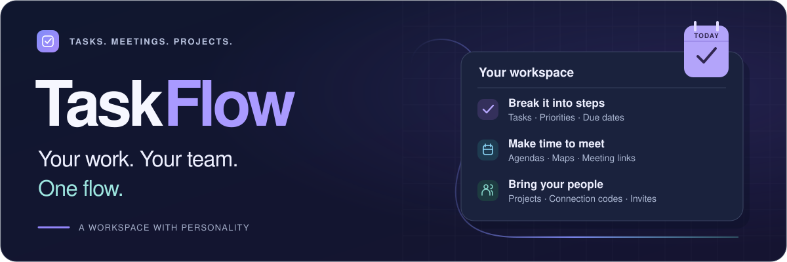
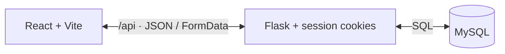

<picture>
  <source media="(max-width: 640px)" srcset="static/svg_pics/hero-mobile.svg" />
  
</picture>

<p align="center">
  <a href="#experience">Explore the interface</a> ·
  <a href="#capabilities">See what it does</a> ·
  <a href="#built-with">Under the hood</a>
</p>

TaskFlow brings **tasks, meetings and project invitations** into one expressive workspace. Plan your day, break work into steps and see your progress through a React interface backed by Flask and MySQL.

## Experience

### 01 / A welcoming way in

Username and password, Google sign-in flows and email OTP verification, with a playful 3D introduction.

<table><tr><td>
  <br/>
  <a href="static/project_reference_images/auth_darkmode.png"></a>
</td></tr></table>

### 02 / Give your day some clarity

Pending, due today, completed and overdue counts put the next step in view.

<table><tr><td>
  <br/>
  <a href="static/project_reference_images/dashboard_one.png"></a>
</td></tr></table>

### 03 / Watch the work add up

Search and filter your tasks, check off a step and follow completion by category.

<table><tr><td>
  <br/>
  <a href="static/project_reference_images/dashboard_two.png"></a>
</td></tr></table>

<sub>Original application captures. Select any screenshot to inspect it at full resolution.</sub>

## Capabilities

| Plan with purpose | Keep the context |
| :--- | :--- |
| **Tasks & steps** — priorities, categories, due dates and completion tracking. | **Meetings & maps** — agendas, online links and geocoded venues with Leaflet. |
| **Calendar** — monthly task and meeting views with detail panels. | **Project invitations** — create projects, find teammates by connection code and accept or decline invites. |
| **Progress at a glance** — task counts, completion rings and category breakdowns. | **Personal touches** — theme switching, interactive 3D and an in-app notification inbox. |

## Built with

| Layer | Technology |
| :--- | :--- |
| **Interface** | React 19 · Vite 8 · React Router 7 |
| **API** | Python · Flask · Flask-CORS · Werkzeug |
| **Data** | MySQL · MySQL Connector/Python |
| **Interaction** | Three.js · React Three Fiber · Drei · React Leaflet |
| **Identity & email** | Google Identity Services · Flask sessions · Gmail SMTP |

### One workspace, three layers



[React hooks](src/hooks) manage fetching and derived dashboard state through a [shared API helper](src/api.js). [Flask routes](backend.py) handle tasks, meetings and notifications; the [user blueprint](user.py) handles accounts, profiles and project invitations. [One connection module](db.py) supplies MySQL access. During development, [Vite](vite.config.js) proxies `/api` and `/static` to Flask.

## Run locally

**Prerequisites:** Node.js 22.12+ (or 20.19+), Python 3 and MySQL.

**Database required:** This repository does not include schema SQL or a database bootstrap script. Obtain a compatible `todolist` schema from the maintainer before running the full application.

<details>
<summary><strong>Configure and start your workspace</strong></summary>

**1. Install the dependencies**

```sh
git clone https://github.com/thonedra-dev/TaskFlow.git
cd TaskFlow
npm ci
python -m venv .venv
```

Activate the Python environment with `.\.venv\Scripts\Activate.ps1` in PowerShell, or `source .venv/bin/activate` on macOS/Linux, then install the backend dependencies:

```sh
python -m pip install Flask Flask-Cors mysql-connector-python requests
```

**2. Connect the database and services**

- Import the compatible schema into MySQL and update `DB_CONFIG` in [db.py](db.py). The current defaults use database `todolist` and port **4306**; set the host, port and credentials for your instance.
- Create `client_secret.json` in the repository root with the structure below. [user.py](user.py) reads it at startup. The file is ignored by Git; Gmail credentials are needed for OTP and account email delivery.

```json
{
  "app": {
    "sender_email": "you@gmail.com",
    "sender_password": "YOUR_GMAIL_APP_PASSWORD",
    "upload_folder": "static/uploads/profile_pics"
  }
}
```

- For Google sign-in, replace `GOOGLE_CLIENT_ID` in [useGoogleAuth.js](src/hooks/useGoogleAuth.js) with your Google web client ID and configure `http://localhost:5173` as an authorized JavaScript origin.

**3. Start both servers from the repository root**

```sh
# Terminal 1 — Python environment activated
python backend.py

# Terminal 2
npm run dev
```

Open **http://localhost:5173/auth**. Flask listens on **http://localhost:5000**. `npm run build` builds the frontend; Flask does not currently serve that build.

This is a development project: Flask uses debug mode and a placeholder session secret, and the Google flow still needs server-side credential verification before deployment.

</details>

---

<p align="center"><sub>TaskFlow · Designed and built by <a href="https://github.com/thonedra-dev">thonedra-dev</a></sub></p>
